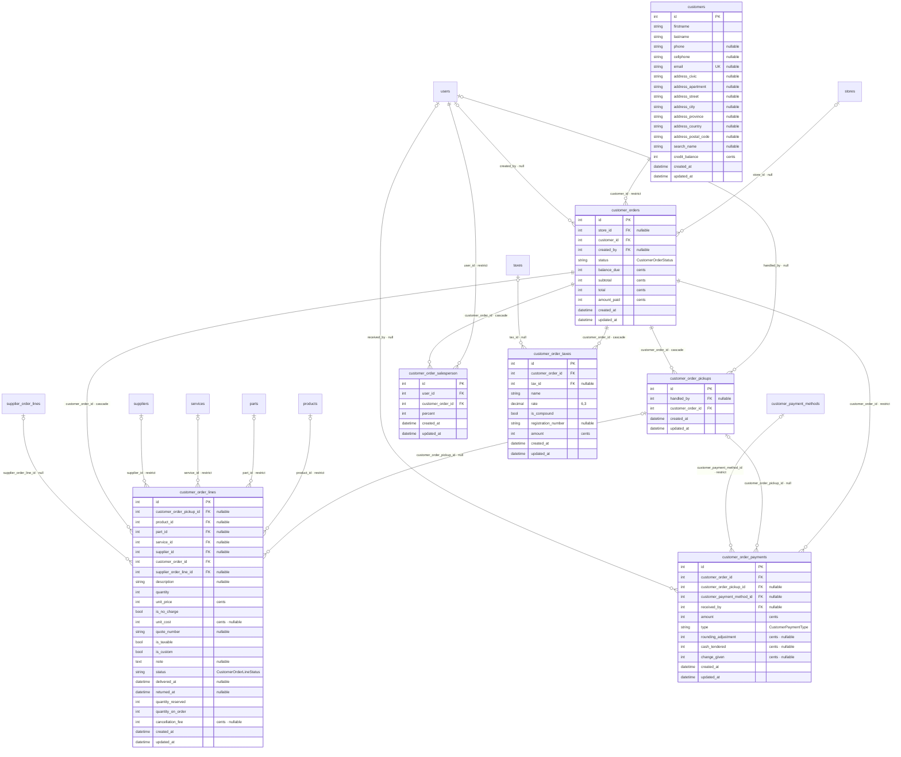
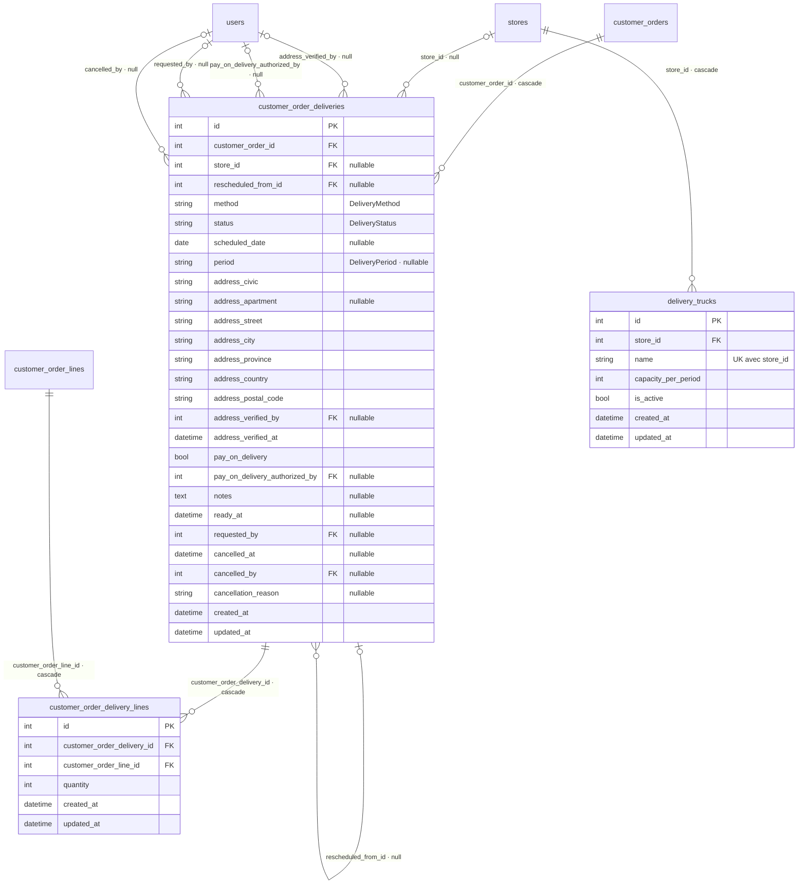
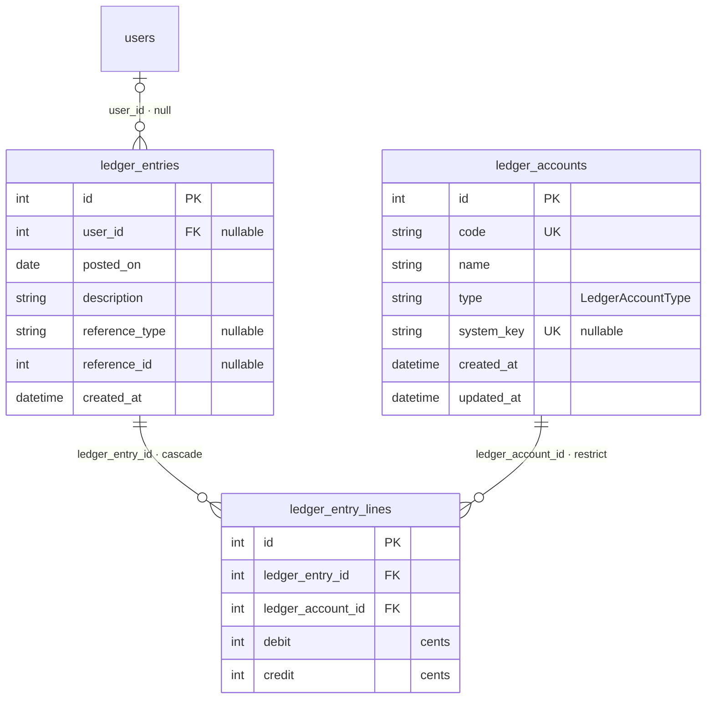
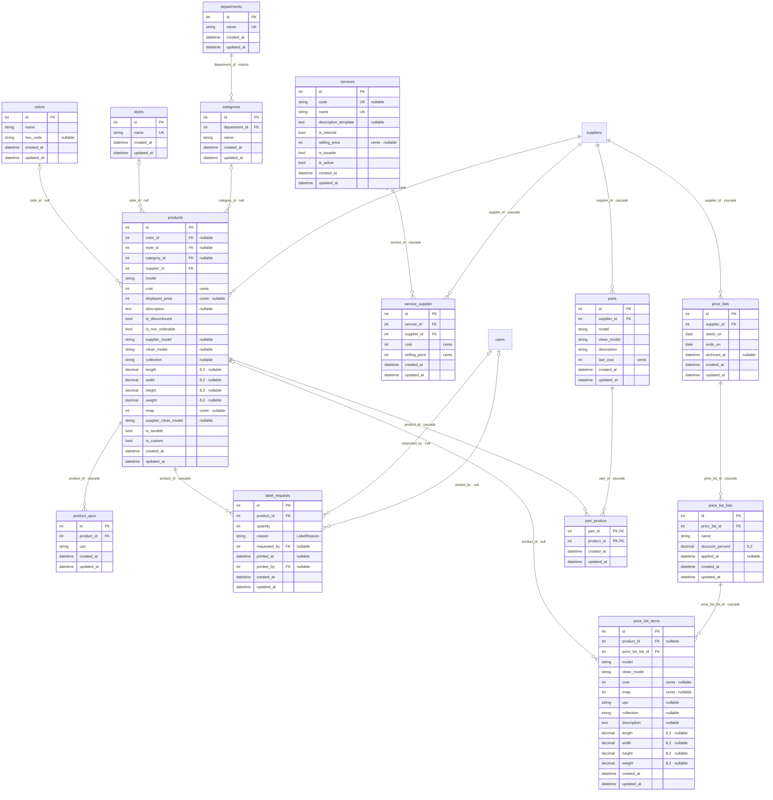
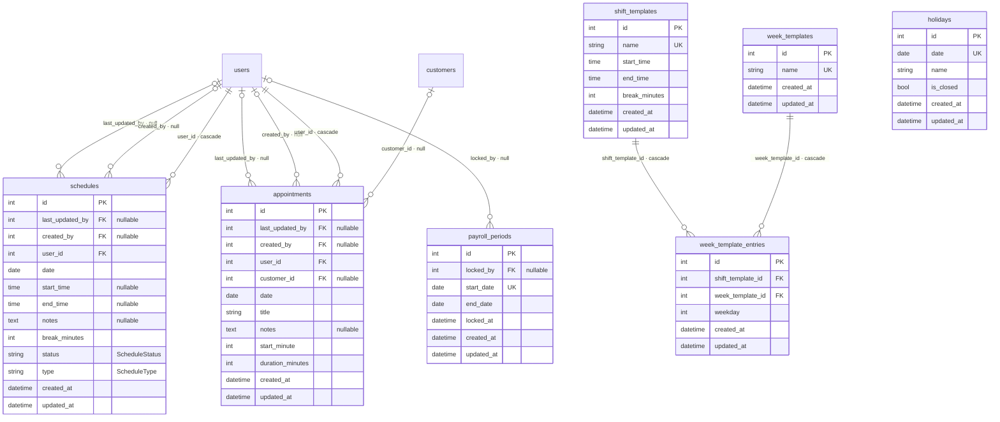
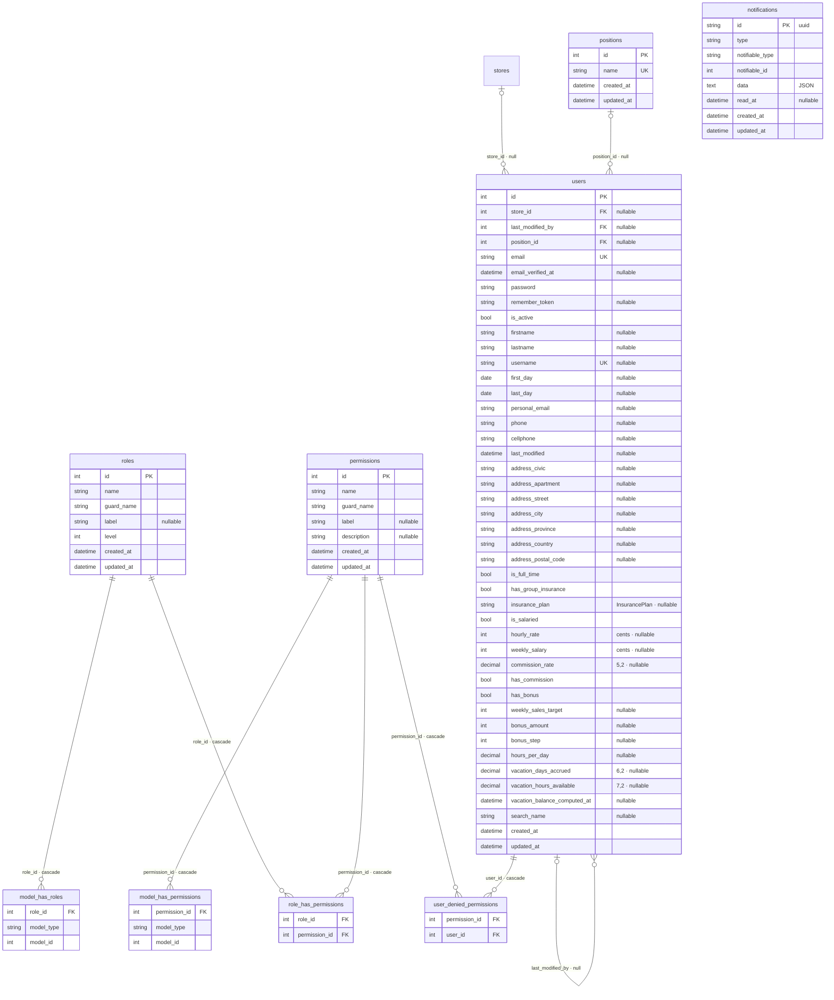
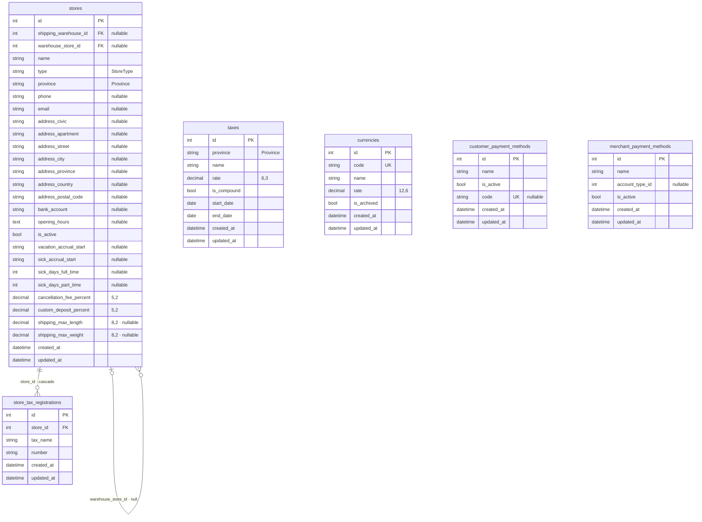

# Modèle de données

Schéma de la base au 2026-10-18 (160 migrations, 57 tables métier). La source exacte du schéma est
le dump SQL [`database/schema/sqlite-schema.sql`](../database/schema/sqlite-schema.sql), à jour avec
les 160 migrations (`php artisan schema:dump`). Les conventions (montants, statuts, règles de suppression, données de référence)
sont expliquées dans l'[ADR 0006](adr/0006-database.md).

## Comment lire les diagrammes

- **Une boîte vide** est une table d'un autre domaine : elle est détaillée dans sa propre section.
- **Clés :** `PK` clé primaire, `FK` clé étrangère, `UK` valeur unique.
- **Notes entre guillemets :** `cents` pour un montant d'argent (entier en cents, casté en `Money`,
  [ADR 0008](adr/0008-money-in-cents.md)), précision d'un décimal (`8,4`) pour un taux ou une mesure, enum PHP casté dans le modèle
  (`CustomerOrderStatus`), `nullable`.
- **Types :** `int`, `string`, `decimal`, `bool`, `text`, `date`, `datetime`, `time`.
- **Cardinalités :**

  | Symbole | Sens |
  |---|---|
  | `\|\|--o{` | Le parent est obligatoire, il a zéro ou plusieurs enfants |
  | `\|o--o{` | Le parent est optionnel (clé étrangère `nullable`) |
  | `\|\|--o\|` | Un pour un (clé étrangère unique) |

- **Étiquette d'une relation :** colonne de la clé étrangère · règle de suppression du parent
  (`restrict` : suppression refusée, `cascade` : enfants supprimés aussi, `null` : la clé devient vide).

## Sommaire

- [Vue d'ensemble](#vue-densemble)
- [Clients et ventes](#clients-et-ventes)
- [Livraisons](#livraisons)
- [Fournisseurs, réceptions et factures](#fournisseurs-réceptions-et-factures)
- [Inventaire](#inventaire)
- [Grand livre](#grand-livre)
- [Catalogue, services et listes de prix](#catalogue-services-et-listes-de-prix)
- [Horaires, rendez-vous et paie](#horaires-rendez-vous-et-paie)
- [Usagers et accès](#usagers-et-accès)
- [Magasins, taxes et paramètres](#magasins-taxes-et-paramètres)
- [Tables techniques de Laravel](#tables-techniques-de-laravel)

## Vue d'ensemble

Relations entre les domaines, sans les colonnes. Les usagers et les tables d'accès sont retirés pour
la lisibilité : presque toutes les tables y sont reliées (`created_by`, `user_id`…).

```mermaid
erDiagram
    stores |o--o{ customer_orders : ""
    customers ||--o{ customer_orders : ""
    customer_order_pickups |o--o{ customer_order_lines : ""
    products |o--o{ customer_order_lines : ""
    parts |o--o{ customer_order_lines : ""
    services |o--o{ customer_order_lines : ""
    suppliers |o--o{ customer_order_lines : ""
    customer_orders ||--o{ customer_order_lines : ""
    supplier_order_lines |o--o{ customer_order_lines : ""
    customer_orders ||--o{ customer_order_payments : ""
    customer_order_pickups |o--o{ customer_order_payments : ""
    customer_payment_methods |o--o{ customer_order_payments : ""
    customer_orders ||--o{ customer_order_pickups : ""
    customer_orders ||--o{ customer_order_salesperson : ""
    customer_orders ||--o{ customer_order_taxes : ""
    customer_orders ||--o{ customer_order_deliveries : ""
    stores |o--o{ customer_order_deliveries : ""
    customer_order_deliveries ||--o{ customer_order_delivery_lines : ""
    customer_order_lines ||--o{ customer_order_delivery_lines : ""
    stores ||--o{ delivery_trucks : ""
    taxes |o--o{ customer_order_taxes : ""
    stores ||--o{ store_tax_registrations : ""
    currencies |o--o{ suppliers : ""
    suppliers |o--o{ supplier_orders : ""
    suppliers ||--o{ supplier_orders : ""
    supplier_orders ||--o{ supplier_order_lines : ""
    products |o--o{ supplier_order_lines : ""
    parts |o--o{ supplier_order_lines : ""
    suppliers ||--o{ receptions : ""
    receptions ||--o{ reception_lines : ""
    supplier_order_lines ||--o{ reception_lines : ""
    products |o--o{ reception_lines : ""
    supplier_orders |o--o| supplier_invoices : ""
    suppliers ||--o{ supplier_invoices : ""
    receptions |o--o| supplier_invoices : ""
    supplier_order_lines |o--o{ supplier_invoice_lines : ""
    supplier_invoices ||--o{ supplier_invoice_lines : ""
    reception_lines |o--o{ supplier_invoice_lines : ""
    products ||--o| inventory_stocks : ""
    products ||--o{ inventory_movements : ""
    reception_lines |o--o{ inventory_units : ""
    products ||--o{ inventory_units : ""
    products ||--o{ inventory_adjustments : ""
    inventory_counts ||--o{ inventory_count_lines : ""
    products ||--o{ inventory_count_lines : ""
    inventory_counts ||--o{ inventory_count_sheets : ""
    inventory_zones |o--o{ inventory_count_sheets : ""
    inventory_count_sheets ||--o{ inventory_count_sheet_lines : ""
    inventory_count_sheets ||--o{ inventory_count_scans : ""
    inventory_counts ||--o{ inventory_count_results : ""
    ledger_entries ||--o{ ledger_entry_lines : ""
    ledger_accounts ||--o{ ledger_entry_lines : ""
    reception_lines |o--o{ defective_products : ""
    products ||--o{ defective_products : ""
    customer_orders |o--o{ defective_products : ""
    customer_order_lines |o--o{ defective_products : ""
    supplier_order_lines |o--o{ defective_products : ""
    colors |o--o{ products : ""
    styles |o--o{ products : ""
    categories |o--o{ products : ""
    suppliers ||--o{ products : ""
    services ||--o{ service_supplier : ""
    suppliers ||--o{ service_supplier : ""
    products ||--o{ product_upcs : ""
    departments ||--o{ categories : ""
    products ||--o{ label_requests : ""
    suppliers ||--o{ price_lists : ""
    price_lists ||--o{ price_list_lists : ""
    products |o--o{ price_list_items : ""
    price_list_lists ||--o{ price_list_items : ""
    shift_templates ||--o{ week_template_entries : ""
    week_templates ||--o{ week_template_entries : ""
    customers |o--o{ appointments : ""
    suppliers ||--o{ parts : ""
    products ||--o{ part_product : ""
    parts ||--o{ part_product : ""
```

## Clients et ventes

- Une commande appartient à un client (`restrict`) et à un magasin, dont elle applique la politique
  (frais d'annulation).
- Les lignes, les ramassages et les vendeurs suivent la commande (`cascade`), mais les paiements
  empêchent sa suppression (`restrict`).
- Une ligne client est liée à la ligne fournisseur qui la comble (`supplier_order_line_id`) et au
  ramassage qui l'a remise au client (`customer_order_pickup_id`).
- Une ligne vend **soit** un produit (`product_id`), **soit** un service (`service_id`, avec le
  fournisseur qui le rend dans `supplier_id`, vide pour un service interne, et la `description` précise
  de la vente), **soit** une pièce de remplacement (`part_id`). Les trois clés sont `nullable`.
- Une pièce est toujours commandée pour le client (jamais prise en stock) et ne crée aucun mouvement
  d'inventaire : `quantity_reserved` compte ce qui est reçu et prêt à lui être remis. Son prix de vente
  calculé est figé dans `unit_price` à l'ajout ; `is_no_charge` la remet sans frais (prix à 0 $, ex. :
  sous garantie), tant qu'elle n'est pas remise au client.
- Un article **sur mesure** (`is_custom`) vend un produit gabarit avec ses spécifications
  (`description`), le coût soumis par le fournisseur (`unit_cost`) et son numéro de soumission
  (`quote_number`); il est toujours commandé, jamais pris en stock.
- `unit_price`, `cancellation_fee` et `is_taxable` sont figés sur la ligne au moment de la vente
  ([ADR 0004](adr/0004-cancellation-fee.md)).
- `customer_order_taxes` : taxes copiées sur la commande à sa création (nom, taux, cascade, numéro
  d'inscription du magasin) avec leur montant courant, calculé sur les lignes taxables et les frais
  d'annulation seulement.

## Livraisons

- Une livraison (`customer_order_deliveries`) remet des articles d'une commande sans ramassage : par nos camions
  (`method` = `internal`, à une date et une demi-journée, `period` AM ou PM) ou par expédition (`shipping`,
  issue #86). Elle suit la commande (`cascade`), comme les ramassages ([ADR 0010](adr/0010-customer-order-deliveries.md)).
- L'adresse confirmée avec le client est copiée sur la livraison (`address_*`) avec l'auteur et le moment de la
  vérification; corriger la fiche du client ne change pas une livraison prévue.
- `customer_order_delivery_lines` : quantité prévue par ligne de commande (unique par livraison et ligne). La
  ligne n'est séparée qu'à sa remise au client. Les livraisons actives (`scheduled`, `in_transit`) réservent ces
  quantités : elles ne se ramassent pas et ne peuvent pas être prévues deux fois.
- Une expédition (`shipping`) n'a ni date ni demi-journée; elle doit être payée à 100 % (pas de
  `pay_on_delivery`). `ready_at` note le moment où tous ses articles sont en main et l'avis « Nouvelle expédition à
  faire » envoyé, une seule fois.
- `pay_on_delivery` : le solde exigé sera perçu à la livraison, autorisé par un directeur
  (`pay_on_delivery_authorized_by`).
- Un report annule la livraison (`cancelled_at`, `cancelled_by`, `cancellation_reason`) et en crée une autre qui
  la référence (`rescheduled_from_id`).
- `delivery_trucks` : camions d'un magasin (`cascade`), avec le nombre de livraisons qu'ils font par
  demi-journée (`capacity_per_period`). La capacité d'une demi-journée compte les camions actifs qui ont un
  livreur à l'horaire.

## Fournisseurs, réceptions et factures

- Une facture couvre **soit** une réception (produits), **soit** une commande de services : les deux
  clés sont uniques et `nullable`.
- `supplier_order_lines.substituted_from_line_id` relie une ligne à celle qu'elle remplace
  (substitution par le fournisseur).
- **Erreurs d'expédition :** à la réception, `quantity_short` compte ce qui est annoncé (et facturé) par
  le fournisseur, mais pas reçu. Le manquant ferme la ligne de commande, sans entrer en inventaire, et la
  facture le compte comme facturé. `supplier_invoices.credit_requested` (manquants × coût réel) est la
  demande de crédit qui balance la facture, jusqu'à l'inscription de la note de crédit
  (`credit_note_number`, `credit_received_at`). Un article reçu en trop est une ligne de commande
  `is_overship`, à coût nul.
- Une ligne de pièce (`part_id`) se reçoit comme un produit, mais sans entrer en inventaire. Sa
  réception met à jour `parts.last_cost`. Une pièce liée à une commande ne peut pas être supprimée
  (`restrict`).
- Les documents se protègent en chaîne (`restrict`) : ligne de commande ← ligne de réception ← ligne
  de facture.

```mermaid
erDiagram
    suppliers |o--o{ suppliers : "default_shipping_supplier_id · null"
    currencies |o--o{ suppliers : "currency_id · null"
    suppliers |o--o{ supplier_orders : "shipping_supplier_id · null"
    suppliers ||--o{ supplier_orders : "supplier_id · restrict"
    users |o--o{ supplier_orders : "created_by · null"
    supplier_order_lines |o--o{ supplier_order_lines : "substituted_from_line_id · null"
    supplier_orders ||--o{ supplier_order_lines : "supplier_order_id · cascade"
    products |o--o{ supplier_order_lines : "product_id · null"
    parts |o--o{ supplier_order_lines : "part_id · restrict"
    users |o--o{ receptions : "received_by · null"
    suppliers ||--o{ receptions : "supplier_id · restrict"
    users |o--o{ reception_lines : "reversed_by · null"
    receptions ||--o{ reception_lines : "reception_id · cascade"
    supplier_order_lines ||--o{ reception_lines : "supplier_order_line_id · restrict"
    products |o--o{ reception_lines : "product_id · null"
    supplier_orders |o--o| supplier_invoices : "supplier_order_id · restrict"
    suppliers ||--o{ supplier_invoices : "supplier_id · restrict"
    receptions |o--o| supplier_invoices : "reception_id · restrict"
    users |o--o{ supplier_invoices : "created_by · null"
    supplier_order_lines |o--o{ supplier_invoice_lines : "supplier_order_line_id · restrict"
    supplier_invoices ||--o{ supplier_invoice_lines : "supplier_invoice_id · cascade"
    reception_lines |o--o{ supplier_invoice_lines : "reception_line_id · restrict"
    suppliers {
        int id PK
        int default_shipping_supplier_id FK "nullable"
        int currency_id FK "nullable"
        string type "SupplierType"
        string name
        string phone "nullable"
        string email "nullable"
        string account_number "nullable"
        string bank_account "nullable"
        string order_email "nullable"
        bool orderable
        bool custom_made
        bool is_active
        decimal price_multiplier "8,4"
        string address_civic "nullable"
        string address_apartment "nullable"
        string address_street "nullable"
        string address_city "nullable"
        string address_province "nullable"
        string address_country "nullable"
        string address_postal_code "nullable"
        string payment_address_civic "nullable"
        string payment_address_apartment "nullable"
        string payment_address_street "nullable"
        string payment_address_city "nullable"
        string payment_address_province "nullable"
        string payment_address_country "nullable"
        string payment_address_postal_code "nullable"
        decimal base_multiplier "8,4"
        decimal customs_fee "8,4"
        decimal shipping_fee "8,4"
        int prepaid_amount "cents · nullable"
        bool collect
        decimal early_payment_discount_percent "5,2"
        int early_payment_discount_days "nullable"
        bool early_payment_next_month
        datetime created_at
        datetime updated_at
    }
    supplier_orders {
        int id PK
        int shipping_supplier_id FK "nullable"
        int supplier_id FK
        int created_by FK "nullable"
        string number UK "nullable"
        string type "SupplierType"
        string status "SupplierOrderStatus"
        text notes "nullable"
        datetime sent_at "nullable"
        datetime received_at "nullable"
        bool is_collect
        string quote_number "nullable"
        datetime last_emailed_at "nullable"
        bool is_drop_ship
        string drop_ship_name "nullable"
        string drop_ship_address_civic "nullable"
        string drop_ship_address_apartment "nullable"
        string drop_ship_address_street "nullable"
        string drop_ship_address_city "nullable"
        string drop_ship_address_province "nullable"
        string drop_ship_address_country "nullable"
        string drop_ship_address_postal_code "nullable"
        datetime created_at
        datetime updated_at
    }
    supplier_order_lines {
        int id PK
        int substituted_from_line_id FK "nullable"
        int supplier_order_id FK
        int product_id FK "nullable"
        int part_id FK "nullable"
        string description "nullable"
        int quantity
        int unit_cost "cents"
        int quantity_received
        int quantity_short
        bool is_overship
        string status "SupplierOrderLineStatus"
        string cancellation_reason "nullable"
        datetime cancellation_requested_at "nullable"
        datetime cancelled_at "nullable"
        datetime created_at
        datetime updated_at
    }
    receptions {
        int id PK
        int received_by FK "nullable"
        int supplier_id FK
        string number UK "nullable"
        datetime received_at
        string reference "nullable"
        text notes "nullable"
        string status "ReceptionStatus"
        datetime completed_at "nullable"
        datetime created_at
        datetime updated_at
    }
    reception_lines {
        int id PK
        int reversed_by FK "nullable"
        int reception_id FK
        int supplier_order_line_id FK
        int product_id FK "nullable"
        int quantity
        int unit_cost "cents"
        int quantity_reversed
        datetime reversed_at "nullable"
        string reversal_reason "nullable"
        int quantity_damaged
        int quantity_short
        datetime created_at
        datetime updated_at
    }
    supplier_invoices {
        int id PK
        int supplier_order_id FK, UK "nullable"
        int supplier_id FK
        int reception_id FK, UK "nullable"
        int created_by FK "nullable"
        string invoice_number
        date invoice_date
        int merchandise_total "cents"
        int freight_fee "cents"
        int customs_fee "cents"
        int taxes "cents"
        int computed_total "cents"
        int invoice_total "cents"
        int variance "cents"
        decimal discount_percent "5,2"
        int discount_days "nullable"
        date discount_due_date "nullable"
        int discount_amount "cents"
        int credit_requested "cents"
        string credit_note_number "nullable"
        date credit_received_at "nullable"
        bool discount_next_month
        string description "nullable"
        datetime created_at
        datetime updated_at
    }
    supplier_invoice_lines {
        int id PK
        int supplier_order_line_id FK "nullable"
        int supplier_invoice_id FK
        int reception_line_id FK "nullable"
        int quantity
        int quantity_short
        int unit_cost "cents"
        datetime created_at
        datetime updated_at
    }
```

## Inventaire

- `inventory_stocks` : quantités courantes par état, une seule ligne par produit (`UK`).
- `inventory_movements` : journal en ajout seulement, qui ne se modifie ni ne se supprime. Sa source
  est une référence **polymorphe** (`reference_type`, `reference_id`), sans clé étrangère : elle ne
  paraît donc pas dans le diagramme.
- `inventory_units` : couches de coût FIFO ([ADR 0011](adr/0011-inventory-movements-and-adjustments.md)) :
  une unité possédée par le magasin, à son coût, avec sa date d'entrée, et sa date et son mouvement de sortie.
  Les unités en main égalent la somme des états valorisés. Les mouvements qui créent, sortent ou rouvrent des
  unités consignent leur valeur (`inventory_movements.value`, en cents).
- `defective_products` : dossier d'un produit défectueux, rapporté par un client ou reçu endommagé
  du fournisseur.
- `inventory_adjustments` : entrée ou sortie d'inventaire sans document d'achat ni de vente (perte, vol,
  usage magasin, correction de comptage, stock initial), immuable. Son mouvement (`inventory_movements`) et
  son écriture (`ledger_entries`) la référencent par leur référence polymorphe.
- `inventory_counts` : prise d'inventaire annuelle. Sa date de comptage date les écritures; `stock_frozen_at`
  marque le gel du stock (compté après la fermeture) jusqu'à la finalisation ou l'abandon.
- `inventory_count_lines` : un produit dans un type de compte (Stock, Stock client, Défectueux, Démonstrateur),
  la quantité comptée ou « conservée », l'attendu figé à la finalisation et l'ajustement créé pour l'écart.
- `inventory_zones` : zones permanentes de l'entrepôt, où le stock se compte zone par zone.
- `inventory_count_sheets` : feuilles de compte d'une prise. Une portée (état compté, et zone pour le stock), une
  passe (A, B ou recompte), le compteur attribué, l'avancement et la réconciliation de la portée.
- `inventory_count_sheet_lines` : quantité comptée d'un produit sur une feuille.
- `inventory_count_scans` : journal des lectures à la douchette (code lu, quantité, produit vide pour un code
  inconnu, annulation).
- `inventory_count_results` : quantités retenues d'une portée réconciliée, avec leur provenance (A = B,
  recompte, superviseur). Elles alimentent `inventory_count_lines`.

```mermaid
erDiagram
    products ||--o| inventory_stocks : "product_id · cascade"
    products ||--o{ inventory_movements : "product_id · restrict"
    users |o--o{ inventory_movements : "user_id · null"
    reception_lines |o--o{ inventory_units : "reception_line_id · null"
    products ||--o{ inventory_units : "product_id · cascade"
    products ||--o{ inventory_adjustments : "product_id · restrict"
    inventory_counts ||--o{ inventory_count_lines : "inventory_count_id · cascade"
    products ||--o{ inventory_count_lines : "product_id · restrict"
    inventory_adjustments |o--o{ inventory_count_lines : "inventory_adjustment_id · null"
    users |o--o{ inventory_counts : "started_by, finalized_by · null"
    users |o--o{ inventory_count_lines : "counted_by · null"
    inventory_counts ||--o{ inventory_count_sheets : "inventory_count_id · cascade"
    inventory_zones |o--o{ inventory_count_sheets : "inventory_zone_id · restrict"
    users |o--o{ inventory_count_sheets : "assigned_to · null"
    inventory_count_sheets ||--o{ inventory_count_sheet_lines : "inventory_count_sheet_id · cascade"
    products ||--o{ inventory_count_sheet_lines : "product_id · restrict"
    inventory_count_sheets ||--o{ inventory_count_scans : "inventory_count_sheet_id · cascade"
    products |o--o{ inventory_count_scans : "product_id · null"
    inventory_counts ||--o{ inventory_count_results : "inventory_count_id · cascade"
    inventory_zones |o--o{ inventory_count_results : "inventory_zone_id · restrict"
    products ||--o{ inventory_count_results : "product_id · restrict"
    users |o--o{ inventory_adjustments : "user_id · null"
    inventory_movements |o--o{ inventory_units : "exit_movement_id · null"
    reception_lines |o--o{ defective_products : "reception_line_id · null"
    products ||--o{ defective_products : "product_id · restrict"
    customer_orders |o--o{ defective_products : "customer_order_id · null"
    customer_order_lines |o--o{ defective_products : "customer_order_line_id · null"
    supplier_order_lines |o--o{ defective_products : "supplier_order_line_id · null"
    users |o--o{ defective_products : "created_by · null"
    inventory_stocks {
        int id PK
        int product_id FK, UK
        int quantity_in_stock
        int quantity_on_order
        int quantity_in_demo
        int quantity_reserved
        int quantity_customer_order
        int quantity_in_delivery
        int quantity_defective_stock
        int quantity_defective_shipped
        int quantity_lost
        datetime created_at
        datetime updated_at
    }
    inventory_movements {
        int id PK
        int product_id FK
        int user_id FK "nullable"
        string from_status "InventoryStatus · nullable"
        string to_status "InventoryStatus · nullable"
        int quantity
        int value "cents · nullable"
        string type "InventoryMovementType"
        string reference_type "nullable"
        int reference_id "nullable"
        string note "nullable"
        datetime created_at
    }
    inventory_units {
        int id PK
        int reception_line_id FK "nullable"
        int product_id FK
        int exit_movement_id FK "nullable"
        int cost "cents"
        date inserted_at
        date delivered_at "sortie · nullable"
        datetime created_at
        datetime updated_at
    }
    inventory_adjustments {
        int id PK
        int product_id FK
        int user_id FK "nullable"
        string reason "InventoryAdjustmentReason"
        string status "InventoryStatus"
        bool is_entry
        int quantity
        string note
        datetime created_at
    }
    inventory_counts {
        int id PK
        int started_by FK "nullable"
        int finalized_by FK "nullable"
        date counted_on
        string status "InventoryCountStatus"
        datetime stock_frozen_at "nullable"
        datetime finalized_at "nullable"
        datetime abandoned_at "nullable"
        datetime created_at
        datetime updated_at
    }
    inventory_count_lines {
        int id PK
        int inventory_count_id FK
        int product_id FK
        int counted_by FK "nullable"
        int inventory_adjustment_id FK "nullable"
        string status "InventoryStatus"
        int counted_quantity "nullable"
        bool is_kept
        int expected_quantity "nullable"
        string note "nullable"
        datetime counted_at "nullable"
        datetime created_at
        datetime updated_at
    }
    inventory_zones {
        int id PK
        string name UK
        int sort_order
        bool is_active
        datetime created_at
        datetime updated_at
    }
    inventory_count_sheets {
        int id PK
        int inventory_count_id FK
        int inventory_zone_id FK "nullable"
        int assigned_to FK "nullable"
        string status "InventoryStatus"
        string pass "InventoryCountPass"
        string state "InventoryCountSheetState"
        datetime started_at "nullable"
        datetime finished_at "nullable"
        datetime reconciled_at "nullable"
        datetime created_at
        datetime updated_at
    }
    inventory_count_sheet_lines {
        int id PK
        int inventory_count_sheet_id FK
        int product_id FK
        int quantity
        datetime created_at
        datetime updated_at
    }
    inventory_count_scans {
        int id PK
        int inventory_count_sheet_id FK
        int product_id FK "nullable"
        int user_id FK "nullable"
        string code "nullable"
        int quantity
        datetime undone_at "nullable"
        datetime created_at
    }
    inventory_count_results {
        int id PK
        int inventory_count_id FK
        int inventory_zone_id FK "nullable"
        int product_id FK
        int reconciled_by FK "nullable"
        string status "InventoryStatus"
        int quantity
        string source "InventoryCountResultSource"
        datetime created_at
    }
    defective_products {
        int id PK
        int reception_line_id FK "nullable"
        int product_id FK
        int customer_order_id FK "nullable"
        int customer_order_line_id FK "nullable"
        int supplier_order_line_id FK "nullable"
        int created_by FK "nullable"
        int quantity
        string resolution "DefectiveResolution"
        string status "DefectiveStatus"
        text reason "nullable"
        string replacement_part "nullable"
        string photo_path "nullable"
        datetime created_at
        datetime updated_at
    }
```

## Grand livre

- `ledger_accounts` : comptes du grand livre. Les comptes système (`system_key` : stock, pertes,
  fournitures, écart d'inventaire, solde d'ouverture) sont créés par `ReferenceDataSeeder`; le comptable en
  change le code et le nom.
- `ledger_entries` : écritures équilibrées et immuables, liées à leur document source par une référence
  **polymorphe** (`reference_type`, `reference_id`), sans clé étrangère.
- `ledger_entry_lines` : un débit ou un crédit en cents par ligne. Seuls les ajustements d'inventaire passent
  des écritures pour l'instant ([ADR 0011](adr/0011-inventory-movements-and-adjustments.md)).

## Catalogue, services et listes de prix

- Un produit appartient à un fournisseur (`cascade`). Il se classe par catégorie, couleur et style.
  `is_taxable` indique s'il est assujetti aux taxes de vente; `is_custom` en fait un gabarit de produit
  sur mesure.
- **Classification :** hiérarchie stricte département → catégorie. Toute catégorie appartient à un
  département (`restrict`), et son nom est unique dans ce département (validé par l'application). Le
  produit ne référence que sa catégorie : son département en est déduit (`Product::department()`,
  `hasOneThrough`).
- **Étiquettes de prix** ([ADR 0009](adr/0009-price-labels.md)) : `products.displayed_price` est le prix
  imprimé sur l'étiquette du démonstrateur. `label_requests` est la file d'impression : une demande par
  produit et par raison (`LabelReason` : manuelle, changement de prix, nouveau démo) tant que
  `printed_at` est vide. Les demandes imprimées restent pour l'historique.
- Une pièce de remplacement (`parts`) est commandée pour un client et n'est pas inventoriée. Elle est
  unique chez son fournisseur par son modèle nettoyé (`supplier_id`, `clean_model`), la même
  normalisation que les produits. `part_product` la relie aux produits qu'elle répare (ex. : les verres
  d'une même famille de lampes). Son prix de vente n'est pas stocké : il est calculé à partir de
  `last_cost` × le multiplicateur du fournisseur, avec l'arrondi des produits (0 $ si elle ne coûte rien).
- Un service (`services`) est **interne** (`is_internal`, rendu par le magasin au `selling_price` du
  service) ou **externe** : offert par un ou plusieurs fournisseurs de service ou d'expédition, chacun
  avec son coût et son prix vendant (`service_supplier`, une offre par paire). `code` identifie un service géré par
  l'application, qui reste interne et actif (`shipping_fee` : frais d'expédition, créé par `ReferenceDataSeeder`). `description_template`
  propose la description de la vente; `{produit}` y est remplacé par le produit visé.
- Hiérarchie des listes de prix : `price_lists` (par fournisseur) → `price_list_lists` (une liste
  nommée avec son escompte, remplie par import CSV) → `price_list_items` (une ligne importée, liée au
  produit une fois trouvé).

## Horaires, rendez-vous et paie

- Les quarts (`schedules`) et rendez-vous (`appointments`) appartiennent à un employé et sont
  supprimés avec lui (`cascade`). En pratique, un employé est désactivé plutôt que supprimé.
- Semaine type : `week_templates` → `week_template_entries` (au plus un quart type par jour de la semaine), appliquée
  à un employé à la fois depuis la gestion des horaires.
- `holidays` : jours fériés, sans lien.
- `payroll_periods` : périodes de paie verrouillées, avec l'auteur du verrouillage.

## Usagers et accès

- Tables de `spatie/laravel-permission` : `roles`, `permissions` et leurs tables de liaison
  ([ADR 0001](adr/0001-permissions.md)).
- `model_has_roles` et `model_has_permissions` sont **polymorphes** (`model_type`, `model_id`) :
  elles n'ont pas de clé étrangère vers `users`, donc ce lien n'est pas dessiné.
- `user_denied_permissions` : permissions retirées à la pièce à un usager. Elles priment sur celles
  de son rôle et sur ses permissions directes.
- `notifications` : notifications de Laravel (canal `database`) affichées par la cloche. Elle est
  **polymorphe** (`notifiable_type`, `notifiable_id`) et n'a pas de clé étrangère vers `users`, donc
  ce lien n'est pas dessiné. `data` (JSON) contient `title`, `body`, `url` et `icon`; `type` identifie
  le rappel (ex. `labels-to-print`).

## Magasins, taxes et paramètres

- Un magasin peut renvoyer à un entrepôt (`warehouse_store_id`) et à un entrepôt d'expédition
  (`shipping_warehouse_id`), qui sont eux-mêmes des magasins.
- `shipping_max_length` et `shipping_max_weight` : plus grande dimension et poids maximum d'un article expédiable
  (dans l'unité des fiches produits); au-delà, la demande d'expédition le signale.
- `taxes` : taux en vigueur par province et par période (`start_date`, `end_date`); une taxe en
  cascade (`is_compound`) se calcule sur le montant plus les taxes individuelles. La province du
  magasin (`province`) détermine les taxes copiées sur ses commandes (`customer_order_taxes`).
- `store_tax_registrations` : numéro d'inscription du magasin pour chaque taxe (un par nom de taxe).
- `customer_payment_methods` : modes de paiement des clients; `code` identifie ceux gérés par le
  code (`cash` pour « Comptant »). `merchant_payment_methods` : modes de paiement du marchand.

## Tables techniques de Laravel

Gérées par le framework, sans lien avec les données métier :

`cache`, `cache_locks`, `failed_jobs`, `job_batches`, `jobs`, `migrations`, `password_reset_tokens`, `sessions`.
